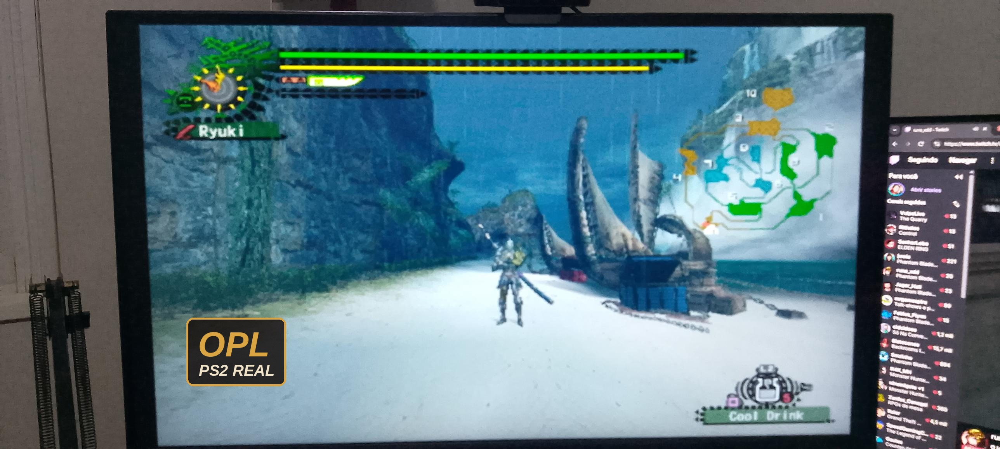

# Monster Hunter 2 (Dos) – Fan Patches

Fan patches for **Monster Hunter 2 (Dos)** (PS2, Japan, `SLPM-66280`) with the **Break Arts** English translation. They work on the **PCSX2** emulator and on a **real PS2** through **OPL** (Open PS2 Loader).

⬇️ **[Download (latest release)](https://github.com/RyukiSTZ/monster-hunter-2-dos-patches/releases/latest)**

🇧🇷 [Leia em português](#-português)

---

## ✨ Features

<!-- Optional: add a before/after comparison here, e.g.
| Original HUD | Patched HUD |
|:---:|:---:|
|  |  |
-->

| Patch                                        | PCSX2            | Real PS2 (OPL)                  |
|----------------------------------------------|:----------------:|:-------------------------------:|
| Smaller minimap                              | ✅               | ✅                              |
| Smaller items / ammo box (bottom-right)      | ✅               | ✅                              |
| Thinner HP bar, smaller ring and player name | ✅               | ✅ (shrinks with the minimap)   |
| Smaller offline chat and keyboard            | ✅               | ❌                              |
| Wider camera (FOV)                           | ✅ +10° to +50°  | ✅ +10° to +40°                 |
| Item box in the online tavern                | ✅               | ✅                              |
| Widescreen                                   | Emulator setting | ✅ (based on Nemesis2000's work) |

HUD changes only apply **during quests**. The village, menus, loading and result screens stay original.

> ⚠️ **Online chat box:** this is the only thing we could not make smaller. On the real PS2, OPL limits cheat files to about 250 code lines, and the chat fix is far bigger than that. Apart from this, the real PS2 experience is very close to the emulator.

## 📋 Requirements

- Monster Hunter 2 (Dos), Japanese release `SLPM-66280`
- Break Arts English translation (tested with **1.0.3** only)
- Game CRC on PCSX2: **`828E80DE`**

No game files are included in this repository. You need your own copy of the game.

## 💾 Installation

### PCSX2

1. Copy the `.pnach` files from the `PCSX2` folder into the PCSX2 **`patches`** folder.
2. Right-click the game › **Properties** › **Patches** tab, enable the patches you want and restart the game. Enable only **one** FOV patch at a time.

### Real PS2 (OPL)

1. Open the `OPL` folder and choose **one** version:
   - `FOV +10`, `FOV +20`, `FOV +30`, `FOV +40`: wider camera + everything else
   - `Sem FOV` (no FOV): original camera, only the HUD, widescreen and tavern box
2. Copy the `SLPM_662.80.cht` file from that folder into the **`CHT`** folder of your device (USB, HDD or SMB).
3. In OPL, open the game options, enable cheats and make sure every entry in the list is checked.

> OPL only reads one `.cht` file per game, so use just one version at a time.

## ❓ Troubleshooting

- **The patch doesn't show up in PCSX2:** check that the game CRC is `828E80DE` (right-click the game › Properties › Summary). The patch is made for the Break Arts translation (tested with 1.0.3), so a different version or an untranslated ISO may not match.
- **Nothing changes in the village or menus:** that's expected. HUD changes only apply during quests.
- **Cheats don't work in OPL:** enable cheats in the game options and make sure every entry in the list is checked. OPL only reads one `.cht` file per game.
- **The online chat box is still big:** this is a known limitation on the real PS2 (see the warning above).

## 📝 Changelog

- **v1.0.0** – First public release.

## 🐞 Bugs and feedback

Found a bug? Open an [issue](https://github.com/RyukiSTZ/monster-hunter-2-dos-patches/issues) or tell me on Discord.

## 🙏 Credits

- **Ryuki** – patches, research and testing
- **Claude (Anthropic)** – helped write the code
- **Nemesis2000** – widescreen for the PS2 version
- **Break Arts** – English translation of the game

## 🔗 Links

- 🌐 Patch website: [https://claude.ai/artifact/A43iaLJa7c3rmTvdhSnJW6](https://claude.ai/artifact/A43iaLJa7c3rmTvdhSnJW6)
- ▶️ YouTube: [https://www.youtube.com/channel/UCrq_bPEtnDPP_5mFUX9wUsA](https://www.youtube.com/channel/UCrq_bPEtnDPP_5mFUX9wUsA)
- 🟣 Twitch: [https://www.twitch.tv/ryuki_live](https://www.twitch.tv/ryuki_live)
- 🟢 Kick: [https://kick.com/ryuki-live](https://kick.com/ryuki-live)
- 💬 Discord: [https://discord.gg/djEMAMFyyE](https://discord.gg/djEMAMFyyE)

## 📄 License

Released under the MIT License. See [LICENSE](LICENSE).

Fan project, non-commercial. Monster Hunter is a trademark of Capcom. This project is not affiliated with Capcom.

---

## 🇧🇷 Português

Patches de fã para o **Monster Hunter 2 (Dos)** (PS2, japonês, `SLPM-66280`) com a tradução em inglês da **Break Arts**. Funcionam no emulador **PCSX2** e no **PS2 de verdade** pelo **OPL** (Open PS2 Loader).

⬇️ **[Baixar (último release)](https://github.com/RyukiSTZ/monster-hunter-2-dos-patches/releases/latest)**

### ✨ O que tem

| Patch                                                     | PCSX2             | PS2 real (OPL)                          |
|-----------------------------------------------------------|:-----------------:|:---------------------------------------:|
| Minimapa menor                                            | ✅                | ✅                                      |
| Itens e caixa de munição menores (canto inferior direito) | ✅                | ✅                                      |
| Barra de vida fina, anel e nome menores                   | ✅                | ✅ (encolhem junto com o minimapa)      |
| Chat offline e teclado menores                            | ✅                | ❌                                      |
| Câmera afastada (FOV)                                     | ✅ +10° a +50°    | ✅ +10° a +40°                          |
| Baú na taverna online                                     | ✅                | ✅                                      |
| Widescreen                                                | Opção do emulador | ✅ (baseado no trabalho do Nemesis2000) |

As mudanças na HUD só valem **durante a missão**. Vila, menus, loading e telas de resultado ficam originais.

> ⚠️ **Caixa do chat online:** foi a única coisa que não conseguimos diminuir. No PS2 real, o OPL aceita cerca de 250 linhas de cheat por arquivo, e a correção do chat é bem maior que isso. Fora isso, a experiência no PS2 ficou quase igual à do emulador.

### 📋 Requisitos

- Monster Hunter 2 (Dos), versão japonesa `SLPM-66280`
- Tradução da Break Arts (testado somente na **1.0.3**)
- CRC do jogo no PCSX2: **`828E80DE`**

Este repositório não inclui nenhum arquivo do jogo. Você precisa ter a sua própria cópia.

### 💾 Instalação

**PCSX2**

1. Copie os arquivos `.pnach` da pasta `PCSX2` para a pasta **`patches`** do PCSX2.
2. Clique com o botão direito no jogo › **Propriedades** › aba **Patches**, marque os patches e reinicie o jogo. Ative só **um** patch de FOV por vez.

**PS2 real (OPL)**

1. Abra a pasta `OPL` e escolha **uma** versão:
   - `FOV +10`, `FOV +20`, `FOV +30`, `FOV +40`: câmera afastada + todo o resto
   - `Sem FOV`: câmera original, só a HUD, o widescreen e o baú na taverna
2. Copie o `SLPM_662.80.cht` de dentro dela para a pasta **`CHT`** do seu dispositivo (USB, HDD ou SMB).
3. No OPL, abra as opções do jogo, ative os cheats e confira se todos os itens da lista estão marcados.

> O OPL só lê um arquivo `.cht` por jogo, então use uma versão de cada vez.

### ❓ Problemas comuns

- **O patch não aparece no PCSX2:** confira se o CRC do jogo é `828E80DE` (botão direito no jogo › Propriedades › Resumo). O patch foi feito para a tradução da Break Arts (testado na 1.0.3), então outra versão ou uma ISO sem tradução pode não bater.
- **Nada muda na vila ou nos menus:** é o esperado. As mudanças na HUD só valem durante a missão.
- **Os cheats não funcionam no OPL:** ative os cheats nas opções do jogo e confira se todos os itens da lista estão marcados. O OPL só lê um arquivo `.cht` por jogo.
- **A caixa do chat online continua grande:** é uma limitação conhecida no PS2 real (veja o aviso acima).

### 📝 Changelog

- **v1.0.0**: primeira versão pública.

### 🐞 Bugs

Achou algum bug? Abra uma [issue](https://github.com/RyukiSTZ/monster-hunter-2-dos-patches/issues) ou me chama no Discord.

### 🙏 Créditos

- **Ryuki**: patches, pesquisa e testes
- **Claude (Anthropic)**: ajudou a escrever o código
- **Nemesis2000**: widescreen da versão PS2
- **Break Arts**: tradução do jogo para o inglês

### 🔗 Links

- 🌐 Site dos patches: [https://claude.ai/artifact/A43iaLJa7c3rmTvdhSnJW6](https://claude.ai/artifact/A43iaLJa7c3rmTvdhSnJW6)
- ▶️ YouTube: [https://www.youtube.com/channel/UCrq_bPEtnDPP_5mFUX9wUsA](https://www.youtube.com/channel/UCrq_bPEtnDPP_5mFUX9wUsA)
- 🟣 Twitch: [https://www.twitch.tv/ryuki_live](https://www.twitch.tv/ryuki_live)
- 🟢 Kick: [https://kick.com/ryuki-live](https://kick.com/ryuki-live)
- 💬 Discord: [https://discord.gg/djEMAMFyyE](https://discord.gg/djEMAMFyyE)

### 📄 Licença

Distribuído sob a licença MIT. Veja [LICENSE](LICENSE).

Projeto de fã, sem fins lucrativos. Monster Hunter é marca da Capcom. Este projeto não tem ligação com a Capcom.
